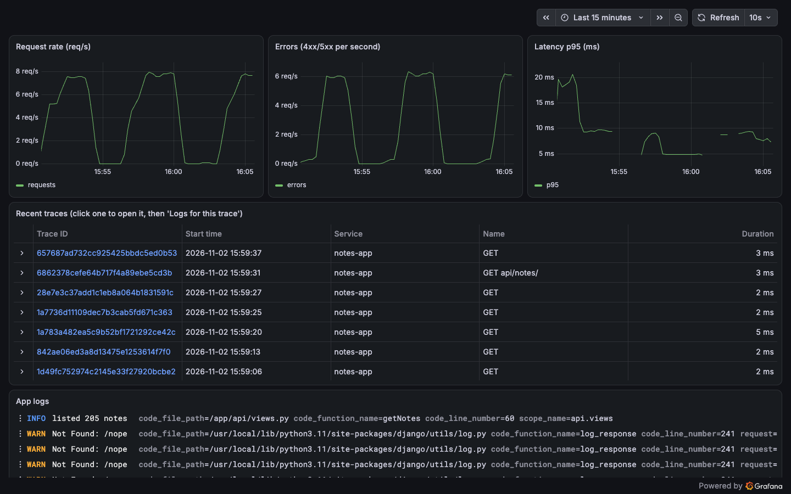
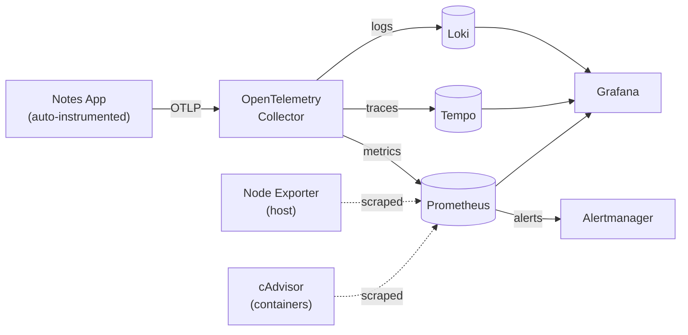
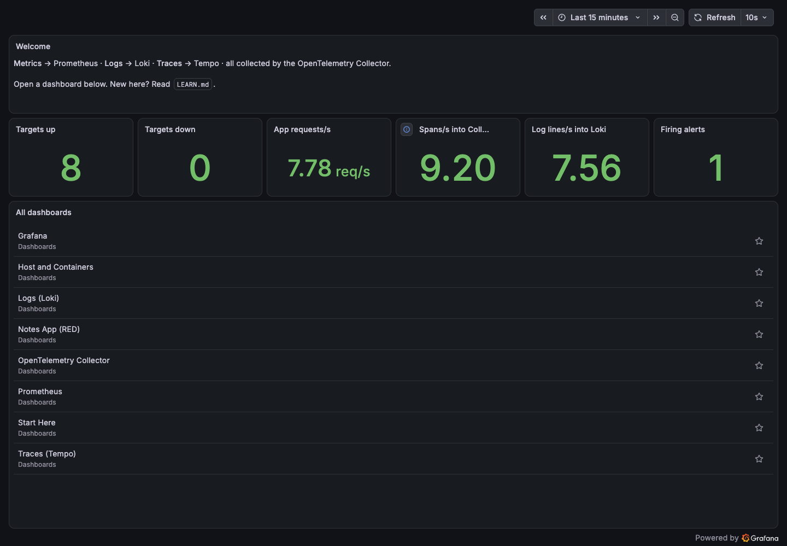
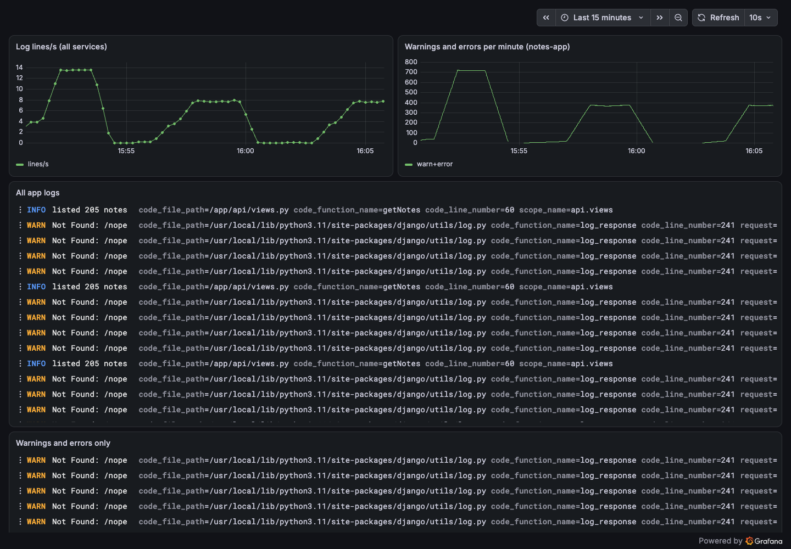
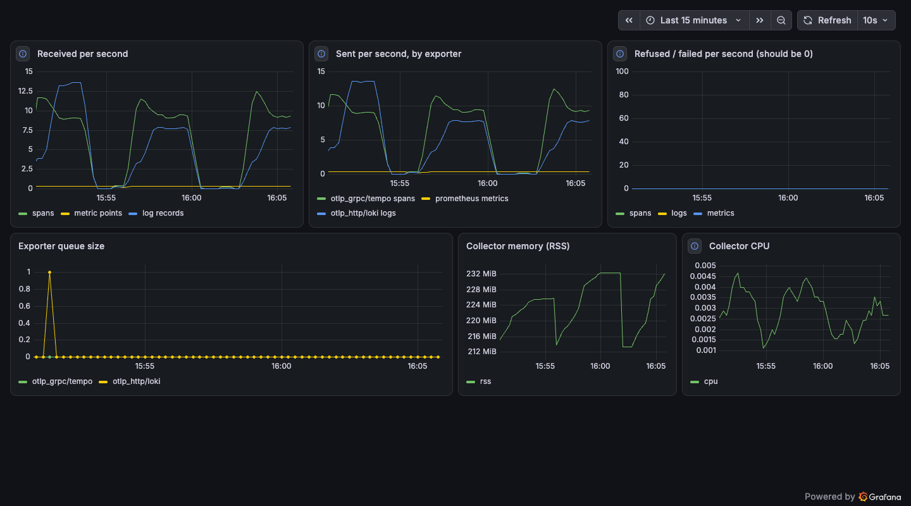
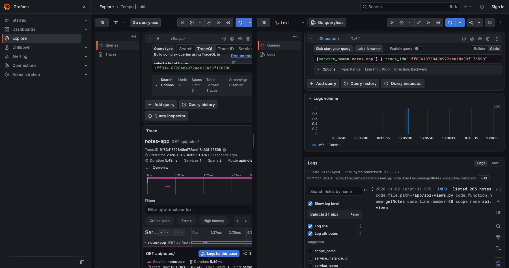
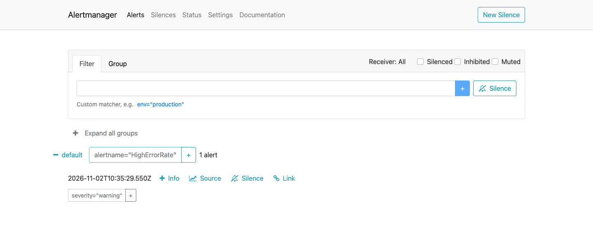

# Observability for DevOps

**Metrics, logs, traces and alerts with Prometheus, Grafana and OpenTelemetry. One `docker compose up` away.**

A hands-on learning stack: a small demo app sends telemetry through the OpenTelemetry Collector to Prometheus, Loki and Tempo, and Grafana ties it all together with ready-made dashboards. Nothing to install except Docker.




## What you'll learn

| Signal | Tool | Answers | Where to see it |
|--------|------|---------|-----------------|
| Metrics | Prometheus | How much? How fast? | *Notes App (RED)* dashboard |
| Logs | Loki | What happened? | *Logs (Loki)* dashboard |
| Traces | Tempo | Where did this request spend its time? | Explore → Tempo |
| Alerts | Alertmanager | Is something wrong right now? | http://localhost:9093 |

Plus how OpenTelemetry collects and routes all of it, and how to jump from a slow trace straight to its logs. The guided path is in **[LEARN.md](LEARN.md)**.

## How it fits together



The app talks to one place, the Collector, which routes each signal to the right backend. Grafana reads from all of them.

## Prerequisites

- Docker with Compose v2 (Docker Desktop on Mac/Windows, or Docker Engine on Linux)
- About 4 GB of free memory for Docker
- Free ports: 3000, 3100, 4317, 4318, 8000, 8080, 9090, 9093

## Quick start

```bash
git clone https://github.com/LondheShubham153/observability-for-devops.git
cd observability-for-devops
docker compose up -d --build
./scripts/traffic.sh          # 60 seconds of demo traffic
```

Open Grafana at http://localhost:3000 (admin / admin). It opens on the **Start Here** dashboard.



| Service | URL |
|---------|-----|
| Grafana | [localhost:3000](http://localhost:3000) |
| Prometheus | [localhost:9090](http://localhost:9090) (try `/targets` and `/alerts`) |
| Alertmanager | [localhost:9093](http://localhost:9093) |
| Loki | [localhost:3100](http://localhost:3100) |
| cAdvisor | [localhost:8080](http://localhost:8080) |
| OTel Collector | `:4317` gRPC, `:4318` HTTP |
| Notes App | [localhost:8000](http://localhost:8000) |

Tempo and Node Exporter run internally and need no exposed port.

## Dashboards

Grafana comes with 8 dashboards, loaded automatically:

| Dashboard | Shows |
|-----------|-------|
| Start Here | Health at a glance, firing alerts, links to everything else |
| Notes App (RED) | Request rate, errors, latency, recent traces, logs |
| Traces (Tempo) | All traces, slow traces, errors, Tempo health |
| Logs (Loki) | Log volume, warnings and errors, live logs |
| OpenTelemetry Collector | What goes in, what is sent where, anything refused |
| Prometheus | Target health, series, scrape times |
| Grafana | Request rate, latency, memory |
| Host and Containers | CPU, memory, disk, per-container usage |





## Try it

1. **Metrics.** Open *Notes App (RED)*. Or go to Explore → Prometheus and run `sum(rate(http_server_duration_milliseconds_count{exported_job="notes-app"}[1m]))`.
2. **Logs.** Explore → Loki and run `{service_name="notes-app"}`.
3. **Traces and the jump to logs.** Explore → Tempo → TraceQL → run `{ name = "GET api/notes/" }` → open a trace, click the `GET api/notes/` row, then click **Logs for this trace**. You land on the logs of that exact request.



App metrics can take up to about 30 seconds to appear (export interval plus Prometheus scrape).

## Alerts

Two alert rules live in `prometheus/alerts.yml`. Trigger them on purpose:

```bash
./scripts/traffic.sh errors 150     # HighErrorRate: most requests fail
docker stop node-exporter           # TargetDown: a scrape target disappears
docker start node-exporter          # ...and recovers
```

Watch them go pending, then firing, at http://localhost:9090/alerts and in Alertmanager.



## Project structure

```
.
├── docker-compose.yml
├── LEARN.md                                 # guided walkthrough
├── scripts/traffic.sh                       # demo traffic generator
├── prometheus.yml                           # what Prometheus scrapes
├── prometheus/alerts.yml                    # alert rules
├── alertmanager/alertmanager.yml
├── otel-collector/otel-collector-config.yml # receivers → processors → exporters
├── loki/loki-config.yml
├── tempo/tempo.yml
├── grafana/provisioning/
│   ├── datasources/datasources.yml          # Prometheus, Loki, Tempo, Alertmanager
│   └── dashboards/json/                     # the 8 dashboards
└── notes-app/                               # Django demo app
```

## Troubleshooting

- **Dashboards are empty:** send traffic with `./scripts/traffic.sh` and wait about 30 seconds.
- **Container panels show IDs instead of names:** Docker Desktop hides container names from cAdvisor. Match an ID to a name with `docker ps --no-trunc`.
- **Errors after pulling new changes:** an old data volume. Run `docker compose down -v`, then start again.

More in the troubleshooting table at the end of [LEARN.md](LEARN.md).

## Next steps

- Send alerts somewhere real: add a Slack or email receiver to `alertmanager/alertmanager.yml`.
- Instrument your own app, in any language. The Collector config stays the same.
- Run the same ideas on Kubernetes with Helm charts.

Official docs: [Prometheus](https://prometheus.io/docs/) · [Grafana](https://grafana.com/docs/grafana/latest/) · [OpenTelemetry](https://opentelemetry.io/docs/) · [Loki](https://grafana.com/docs/loki/latest/) · [Tempo](https://grafana.com/docs/tempo/latest/) · [Alertmanager](https://prometheus.io/docs/alerting/latest/alertmanager/)

## Tear down

```bash
docker compose down          # stop everything, keep data
docker compose down -v       # stop everything and delete all data
```
