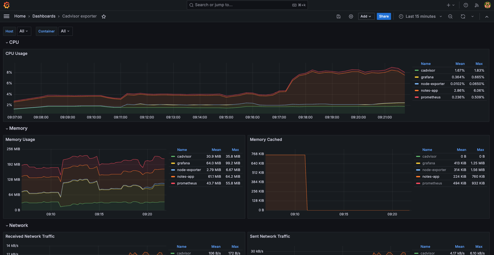
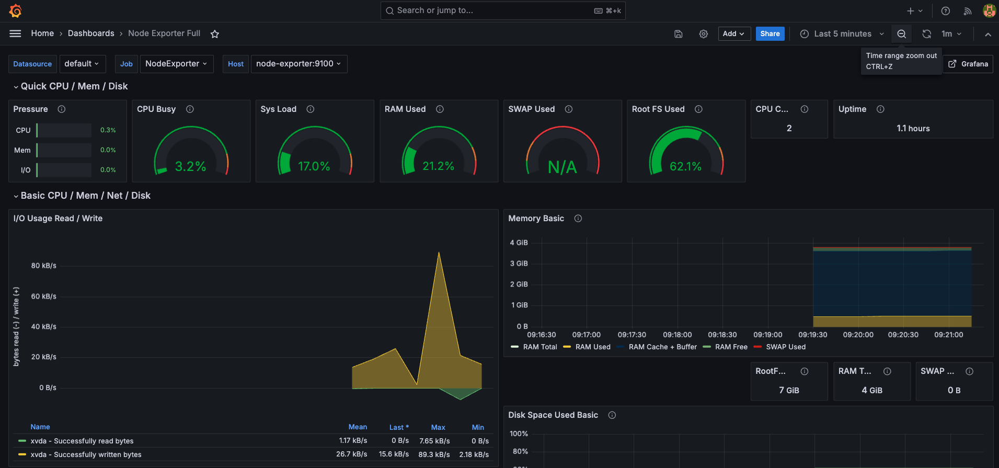

# Observability Stack for DevOps

Metrics, logs, and traces — one `docker compose up` away.




## How it fits together

```
                          ┌─► Prometheus (metrics) ─┐
Notes App ──OTLP──► OTel Collector ─► Tempo (traces) ├─► Grafana
 (auto-instrumented)      └─► Loki (logs) ──────────┘
                                   
Node Exporter, cAdvisor ──scraped by──► Prometheus   (host + container metrics)
```

- The **app** is instrumented with zero code changes (`opentelemetry-instrument`, see `notes-app/Dockerfile`).
- The **Collector** is the single front door: apps send OTLP, it routes each signal to the right backend (`otel-collector/otel-collector-config.yml`).
- **Grafana** reads from all three backends. Datasources are provisioned for you.

## Quick start

```bash
git clone https://github.com/LondheShubham153/Observability-For-DevOps.git
cd Observability-For-DevOps
docker compose up -d --build
```

Grafana: http://localhost:3000 (admin / admin)

| Service | URL |
|---------|-----|
| Grafana | [:3000](http://localhost:3000) |
| Prometheus | [:9090](http://localhost:9090) (check `/targets`) |
| cAdvisor | [:8080](http://localhost:8080) |
| Loki | [:3100](http://localhost:3100) |
| OTel Collector | `:4317` gRPC / `:4318` HTTP |
| Notes App | [:8000](http://localhost:8000) |

## Dashboards (ready on first login)

Grafana opens on **Start Here**, which links to everything else:

| Dashboard | Shows |
|-----------|-------|
| Start Here | Health at a glance, links to all dashboards |
| Notes App (RED) | Rate, errors, latency, recent traces, logs |
| Traces (Tempo) | All traces, slow traces, errors, Tempo health |
| Logs (Loki) | Log volume, warnings and errors, live logs |
| OpenTelemetry Collector | Spans/metrics/logs in and out, refused, queues |
| Prometheus | Target health, series, scrape times |
| Grafana | Request rate, latency, memory |
| Host and Containers | CPU, memory, disk, per-container usage |

## Try it

1. **Make some traffic.** Open the [Notes App](http://localhost:8000) and create a few notes. Visiting a bad URL like `/nope` also makes a useful 404.
2. **Metrics.** Grafana → Dashboards → *Notes App (RED)*. Or Explore → Prometheus and run:
   `sum(rate(http_server_duration_milliseconds_count{exported_job="notes-app"}[1m]))`
3. **Traces.** Explore → Tempo → TraceQL → run `{ name = "GET api/notes/" }` → open a trace. Click **Logs for this span** to jump to that request's logs.
4. **Logs.** Explore → Loki and run: `{service_name="notes-app"}`

App metrics can take up to ~30s to appear (export interval + Prometheus scrape).

New to this? Follow the guided walkthrough in **[LEARN.md](LEARN.md)**.

## Project structure

```
.
├── docker-compose.yml
├── prometheus.yml                          # what Prometheus scrapes
├── otel-collector/otel-collector-config.yml # receivers → processors → exporters
├── loki/loki-config.yml
├── tempo/tempo.yml
├── grafana/provisioning/
│   ├── datasources/datasources.yml         # Prometheus, Loki, Tempo (+ trace→logs link)
│   └── dashboards/json/                    # 8 dashboards; drop more JSON here
└── notes-app/                              # Django demo app
```

## Notes

- cAdvisor and Node Exporter mount host paths such as `/var/lib/docker`. On Docker Desktop (Mac/Windows) some container metrics may be missing. Everything else works.
- Images are pinned to specific versions so the lessons keep working.

## Tear down

```bash
docker compose down          # stop everything
docker compose down -v       # stop + delete all data
```
